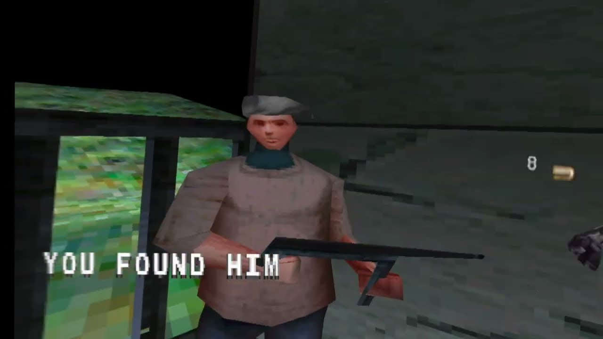

# Medal of Honor Underground Recompiled + Full 6dof VR

<!-- retcomm-readme-metrics -->
[](https://github.com/FractalEngineer/Medal-Of-Honor-Underground-PSX-Recomp/releases)
[](https://github.com/FractalEngineer/Medal-Of-Honor-Underground-PSX-Recomp/releases/latest)
<!-- /retcomm-readme-metrics -->

<!-- retcomm-readme-boxart -->
<p align="center">
  
</p>
<!-- /retcomm-readme-boxart -->

Static recompilation of **Medal of Honor Underground** built on
[psxrecomp](https://github.com/mstan/psxrecomp) and
[recomp-ui](https://github.com/RetroPortingToolKit/recomp-ui).

Play the original game on a flat display, or opt into the experimental Full
6dof VR alpha with head tracking, per-eye rendering and tracked-weapon controls.
Flat play is the default; VR is enabled through a separate launcher.
Watch the [VR video demo](https://youtu.be/_6LRnH667jc) for gameplay footage.

The latest **Windows alpha** is available from this fork's
[releases](https://github.com/FractalEngineer/Medal-Of-Honor-Underground-PSX-Recomp/releases/latest).
See [alpha installation and controls](ALPHA_README.md) before testing.

| | |
|---|---|
| Players | 2 |
| Region | USA |
| Publisher | Electronic Arts |
| Year | 2000 |

Scaffolded with the New Project Layout. See
`psxrecomp/docs/GAME_PROJECT_SETUP.md` for the full flow.

<!-- retcomm-readme-launcher -->
## Retro Launcher

You can run this title **standalone** (download the release zip, point it at
your disc, play), or manage installs, updates, and disc/BIOS wiring with
**[Retro Launcher](https://github.com/RetroPortingToolKit/Retro-Launcher)** -
the Retro Compilation Manager hub for self-compiling recomps.

[Downloads](https://github.com/RetroPortingToolKit/Retro-Launcher/releases) -
[Full README & features](https://github.com/RetroPortingToolKit/Retro-Launcher#readme)

<p align="center">
  
</p>

<p align="center">
  
</p>

Retro checks for updates, installs the prebuilt release zips, and automates
BIOS/ROM/save plumbing so you are not stuck repeating each game's first run by hand.
<!-- /retcomm-readme-launcher -->

## Legal

You must own the original game. Disc images under `disc/` are gitignored and
must never be committed. Retail BIOS dumps are not redistributed and no C
derived from one may be committed; releases run on the bundled MIT OpenBIOS.

`generated/` (the recompiled game C) **is committed**: releases ship the
compiled game, built by CI from that tree. Regenerate and commit it whenever
seeds or the framework pin change.

Default app icon: `assets/psxrecomp.ico` (and `.png` / `.svg`) - Retro-themed controller mark from `psxrecomp/assets/`. Windows builds embed it via `APP_ICON`.

Optional box art under `launcher_assets/img/` may come from
[libretro-thumbnails](https://github.com/libretro-thumbnails/libretro-thumbnails)
(`Named_Boxarts`); see `BOXART_SOURCE.txt` when present.

## Flat play

Launch `Medal_of_Honor_Underground_Recompiled.exe` normally and select your own
disc image in the launcher. No headset is required. The supported disc is
**SLUS-01270 (NTSC-U)**; game data is not included.
The Windows release also includes `RunFlat.bat`, which clears VR overrides.

For a local Windows build, launch from the project root in a fresh terminal:

```powershell
.\build-release\Medal_of_Honor_Underground_Recompiled.exe --game game.toml --disc "C:\Games\Medal of Honor Underground\game.cue"
```

Replace the example disc path with your own. Add `--no-launcher` to boot
directly. OpenXR support can be compiled into the same executable while ordinary
launches retain flat rendering and normal controller input. VR environment
overrides should be absent for flat play; the VR wrapper restores its process
environment when it exits.

`RunVR-SteamVR.bat -Headless` is a stereo diagnostic mode, not the ordinary flat launch.

## Experimental VR alpha (Windows)

The current [Windows Alpha](https://github.com/FractalEngineer/Medal-Of-Honor-Underground-PSX-Recomp/releases/latest)
adds native OpenXR stereo rendering and head tracking, tracked weapons and a
surface-aware laser, a left-wrist native HUD and damage marker, wrist-mounted
objective camera support, native frontend rendering, and a held 2.5x sniper
scope with native scope range. It uses the same `saves/` directory as flat play.
The owner accepted the tested camera, HUD, frontend, pause, Sten and music behavior.
The primary tested setup is Quest 3 through Virtual Desktop with **VDXR**;
demanding scenes can still slow down.

<p align="center">
  <a href="https://youtu.be/_6LRnH667jc" title="Watch the Medal of Honor Underground VR alpha gameplay demo">
    
  </a>
  <br>
  <a href="https://youtu.be/_6LRnH667jc"><strong>&#9654; WATCH THE VR ALPHA GAMEPLAY DEMO</strong></a>
</p>

### Setup and launch

Download the Windows release and extract the entire ZIP. Connect your headset
and double-click the launcher for your runtime: `RunVR-VDXR.bat` (Virtual
Desktop VDXR), `RunVR-SteamVR.bat` or `RunVR-Oculus.bat` (Meta Quest Link / Air
Link). Each selects that runtime for the launch and leaves the system's active
runtime unchanged. Select your own
**SLUS-01270 (NTSC-U)** CUE/BIN image when prompted; the launcher remembers its
location. Keep the BIN files beside the CUE.

Boot videos, menus and briefing appear on a screen in VR; gameplay switches to
per-eye rendering. No save state, Python installation or development tools are
required. The game runs until you close it, and startup errors remain visible
in the console. Keep your `saves/` folder when updating.

To select a disc explicitly:

```powershell
.\RunVR-VDXR.bat -DiscPath "C:\Games\Medal of Honor Underground\game.cue"
```

Use `RunFlat.bat` for ordinary flat play. See
[ALPHA_README.md](ALPHA_README.md) for further installation details and alpha
limitations.

### Current Touch controls

| Control | Gameplay |
| --- | --- |
| Left stick | Move / strafe |
| Right stick | Smooth turn |
| Right trigger | Fire |
| A | Reload / use, according to game context |
| B | Cycle weapon |
| Right stick click | Toggle crouch |
| Left stick click | Jump |
| Left Menu button | Pause / Start |
| Right grip | Hold to show the barrel laser; hold for sniper scope |
| Left grip | Hold to aim a mounted machine gun or objective camera with one stick |

In menus, the left stick navigates, A or right trigger confirms, and B goes back.

The barrel laser is a laser sight on the tracked weapon: **hold the right grip**
and the beam runs from the muzzle to whatever it hits, with a dot marking the
impact. It appears for firearms only. The sniper scope keeps the same laser and
does not pin player movement.

A mounted machine gun or objective camera aims with a single stick: **hold the
left grip** and one hand covers both axes. Let go and normal movement returns.

### Report issues and contribute

Report problems in this fork's
[issue tracker](https://github.com/FractalEngineer/Medal-Of-Honor-Underground-PSX-Recomp/issues).
Include the build version, headset, OpenXR runtime, connection method,
mission/location, steps to reproduce, and any relevant captures. Mention whether
the issue also occurs in flat play. Do not attach disc images or retail BIOS dumps.

For development context, start with the
[VR handoff](docs/vr/HANDOFF.md) and
[VR documentation](docs/vr/README.md). Game-specific weapons, controls
and HUD changes belong here; generic framework work is tracked in
[the upstream inventory](docs/vr/FRAMEWORK_UPSTREAM_TRACKER.md).

## Development build

```bash
git submodule update --init --recursive
./psxrecomp/tools/ci/build_emitters.sh
python3 psxrecomp/psxrecomp_cli.py generate \
  --config game.toml --project-root . --disc disc/<your>.cue
git add generated && git commit -m "Regenerate game C"
cmake -S . -B build-release -G Ninja -DCMAKE_BUILD_TYPE=Release \
  -DPSXRECOMP_BIOS_STEMS=OpenBIOS -DPSX_OPENXR=ON \
  -DMOHU_VR_DIAGNOSTICS=ON -DMOHU_VR_NATIVE_PROFILE=OFF \
  -DPSX_DEBUG_TOOLS=OFF -DPSX_RUNTIME_IPO=OFF
cmake --build build-release --target psx-runtime
```

The generated game C is already committed; ordinary builds do not regenerate it.

For Windows VR, configure the Release build with `-DPSX_OPENXR=ON` and
`-DMOHU_VR_DIAGNOSTICS=ON`, or use `RunVR-VDXR.bat -Build` after preparing the
build tools and generated game C. Compiling OpenXR support does not
automatically enable VR when launching the executable.

Windows releases use a CI-built Windows-only alpha package with OpenXR and the
guarded VR plugin enabled. Other `vX.Y.Z` tags (or the *Release builds*
workflow) build the committed `generated/` C for Windows x64 and attach
`mohu-<version>-windows-x64.zip`, the compiled game. Locally:
`scripts/package_release.sh build-release windows-x64`.
Windows packaging requires the public release channel, OpenXR and the VR plugin
(`-DPSX_RELEASE_CHANNEL=public -DPSX_OPENXR=ON -DMOHU_VR_DIAGNOSTICS=ON`), and
includes the flat and VR launchers.

## Symbols

Progressive map: `symbols.toml` -> `python3 tools/sync_symbols.py` ->
`psx_symbols.h` (`PSX_FN_*`). See `psxrecomp/docs/SYMBOLS.md`.

## Framework pins

Submodule gitlinks (`psxrecomp`, optional `recomp-ui`, nested `recomp-net`)
are authoritative. `framework_pins.txt` is an optional scaffold snapshot;
release CI logs SHAs with `record_pins.sh` but builds whatever the gitlinks
resolve to. Bump submodules deliberately - do not float on `main`/`master`
in release CI.

<!-- retcomm-readme-raid -->
---

<p align="center">
  <sub><b>R.A.I.D. - Retro AI Development</b> | a Discord for AI-assisted retro reverse-engineering, decomp &amp; recomp</sub>
</p>

<p align="center">
  <a href="https://discord.gg/Ad9BwSzctP"></a>
</p>
<!-- /retcomm-readme-raid -->
